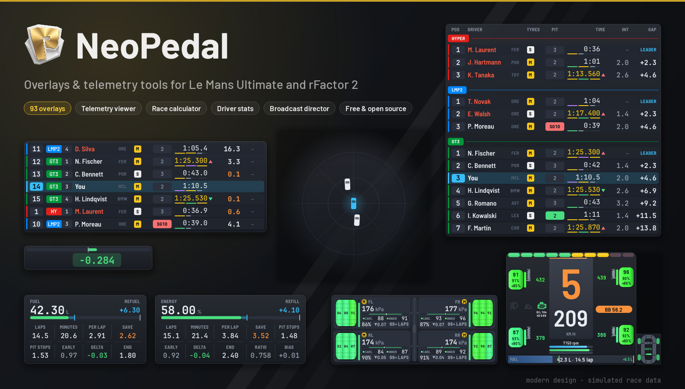
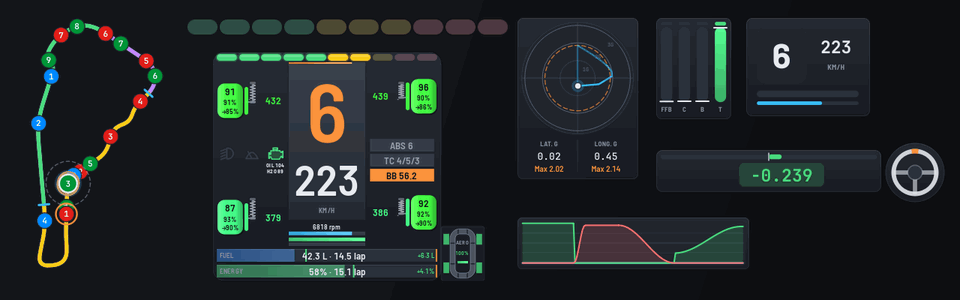
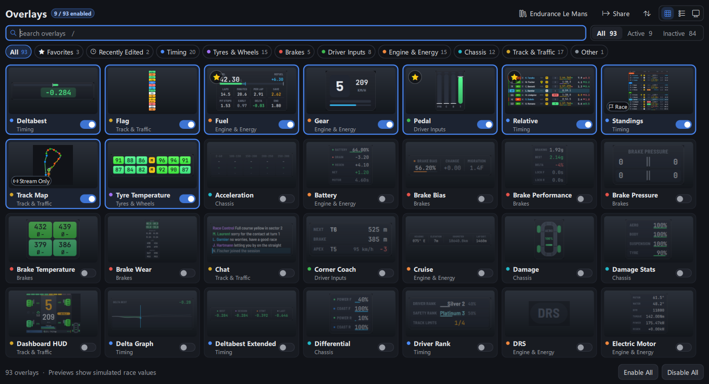
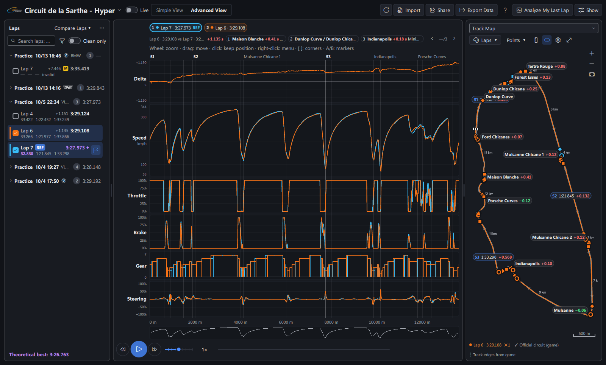
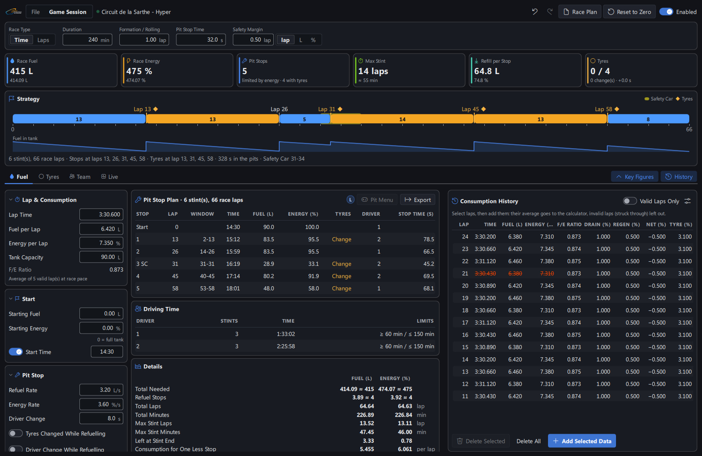
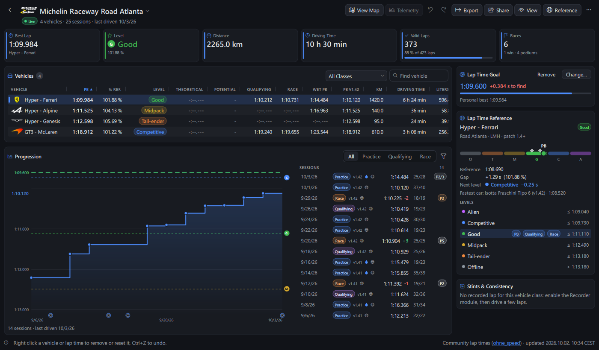
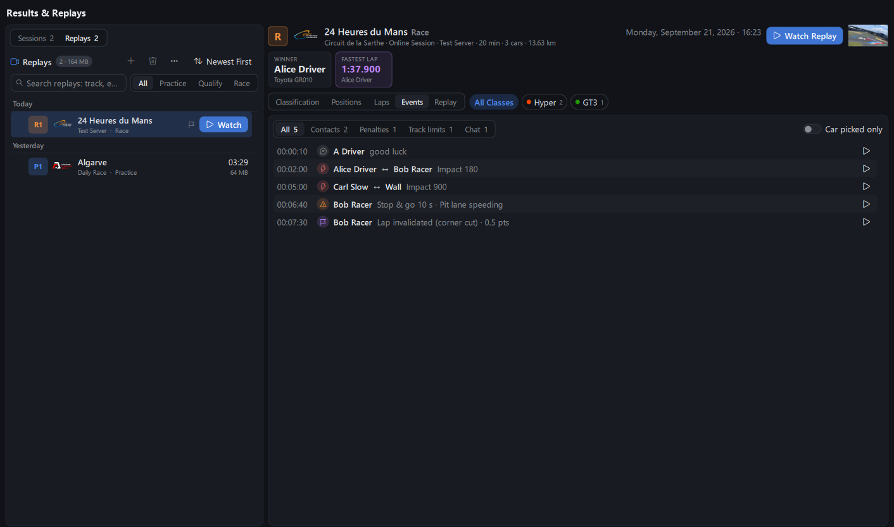
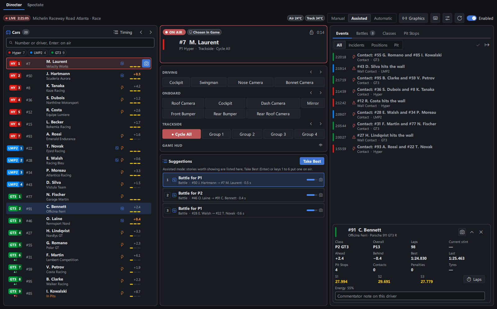
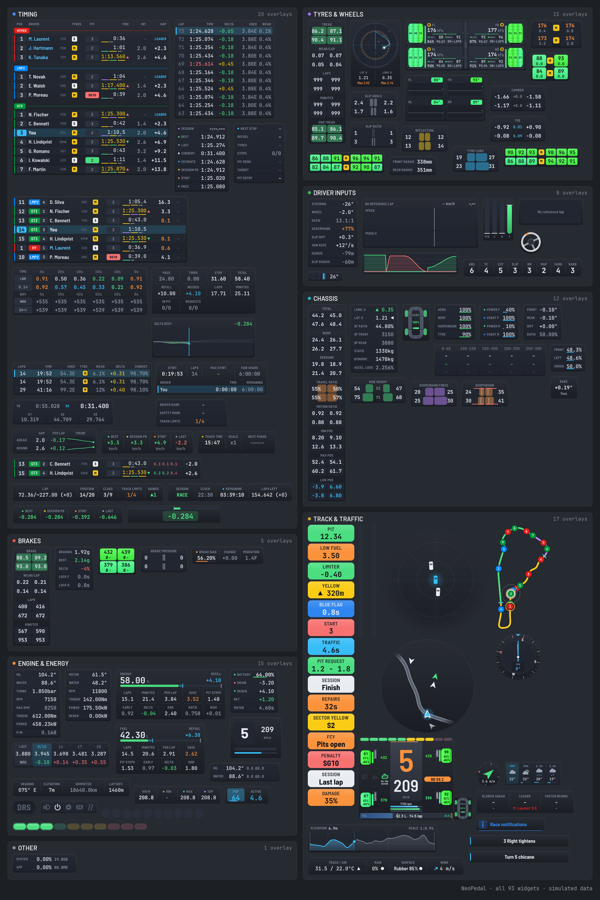

<p align="center">
  <a href="https://github.com/Keenny38/NeoPedal/releases/latest">
    
  </a>
</p>

<p align="center">
  <a href="https://github.com/Keenny38/NeoPedal/releases/latest"></a>
  <a href="https://github.com/Keenny38/NeoPedal/releases"></a>
  <a href="LICENSE.txt"></a>
  
</p>

<h3 align="center">
  <a href="https://github.com/Keenny38/NeoPedal/releases/latest">📥 Télécharger pour Windows</a>
</h3>

<p align="center">
  <a href="#-démarrage-rapide">Démarrage rapide</a> ·
  <a href="#-ce-que-tu-as">Fonctions</a> ·
  <a href="#-sûr-à-utiliser">Sûr à utiliser</a> ·
  <a href="https://github.com/Keenny38/NeoPedal/wiki">Wiki</a> ·
  <a href="CHANGELOG.fr.md">Nouveautés</a> ·
  <a href="#-soutenir-le-projet">Soutenir</a>
</p>

<p align="center"><a href="README.md">English</a> · <b>Français</b></p>

<p align="center"></p>

---

**NeoPedal**, c'est bien plus qu'une app d'overlays : c'est un compagnon complet pour tes courses sur **Le Mans Ultimate** et **rFactor 2**. 93 overlays au design moderne, une visionneuse de télémétrie, un calculateur de stratégie, tes statistiques de pilote, tes résultats et replays, une régie de course et des sources pour ton stream, le tout dans une seule app.

Gratuit, open source, en français et en anglais. Un projet perso que je fais sur mon temps libre, avec l'aide de l'IA, basé sur [TinyPedal](https://github.com/TinyPedal/TinyPedal) (approuvé par son développeur et listé dans ses [projets communautaires](https://github.com/TinyPedal/TinyPedal/wiki#community-projects)).

## 🏁 Démarrage rapide

1. **Télécharge** `NeoPedal-<version>-windows-setup.exe` depuis les [Releases](https://github.com/Keenny38/NeoPedal/releases/latest) et lance-le. Pas besoin des droits administrateur.
2. **Règle le jeu** en `Sans bordure` ou `Fenêtré` (le plein écran exclusif cache les overlays).
   - **Le Mans Ultimate** : rien à installer, active `Settings > Gameplay > Enable Plugins`.
   - **rFactor 2** : installe le [rF2SharedMemoryMapPlugin](https://github.com/TheIronWolfModding/rF2SharedMemoryMapPlugin#download) ([détails](https://github.com/Keenny38/NeoPedal/wiki/Game-Setup)).
3. **Lance NeoPedal** : l'assistant demande ta langue, ton jeu, tes unités, ton thème et les overlays pour commencer.
4. **Roule** : les overlays s'affichent dès que ta voiture est en piste. Déverrouille-les pour les glisser où tu veux.

Les mises à jour sont trouvées et installées depuis l'app. Linux : voir [Lancer depuis les sources](#-lancer-depuis-les-sources).

## 🧰 Ce que tu as

<table>
<tr>
<td width="50%" valign="top">

### 93 overlays, un design moderne
Classement et Relatif comme une tour de chronométrage télé, delta, pneus, freins, carburant et énergie virtuelle, radar, carte du circuit, drapeaux, météo, Dashboard HUD et bien plus. Les mêmes couleurs partout (violet meilleur, vert gain, rouge perte), quatre thèmes, des variantes daltoniennes, et le look classique toujours là.

</td>
<td width="50%" valign="top">



</td>
</tr>
<tr>
<td valign="top">



</td>
<td valign="top">

### Visionneuse de télémétrie
Chaque tour enregistré et dessiné par la carte graphique. Compare tes tours, vois **où tu perds du temps** en mots simples (« Freine 6 m plus tôt »), ta trajectoire sur la carte officielle du circuit, ton rythme sur la session, l'import et l'export MoTeC, et ton tour de référence en direct sur la piste.

</td>
</tr>
<tr>
<td valign="top">

### Calculateur de course
Carburant, énergie virtuelle et pneus sur une page : plan des arrêts tour par tour, scénarios voiture de sécurité et pluie, plusieurs pilotes avec leurs temps de conduite, et le plan recalculé **en direct** à chaque tour depuis ta voiture.

</td>
<td valign="top">



</td>
</tr>
<tr>
<td valign="top">



</td>
<td valign="top">

### Statistiques du pilote
Tes temps par circuit et par voiture face aux temps de la communauté LMU, avec ton niveau d'Alien à Offline, ta progression session après session, des objectifs de temps au tour, tes records sur sec et sur mouillé, et les sessions importées depuis les résultats du jeu.

</td>
</tr>
<tr>
<td valign="top">

### Résultats et replays
Chaque session jouée, en ligne ou hors ligne, lue dans les fichiers du jeu : classement, positions tour par tour, contacts et pénalités, avec un bouton lecture qui ouvre **le replay à ce moment-là**.

</td>
<td valign="top">



</td>
</tr>
<tr>
<td valign="top">



</td>
<td valign="top">

### Régie de course et stream
Réalise la diffusion d'une course Le Mans Ultimate en direct ou en replay : toutes les caméras en un clic, un réalisateur assisté ou automatique (bagarres, dépassements, contacts, arrêts au stand), des graphismes télé pour OBS, et chaque overlay en source navigateur.

</td>
</tr>
</table>

**Et aussi** : une page d'accueil qui vérifie ce qui empêche tes overlays de s'afficher, les courses à venir avec rappels, un tableau de bord web pour ton téléphone, des raccourcis sur ton volant ou ta button box, le contrôle à distance par Stream Deck et SimHub, un overlay SteamVR, des presets par catégorie et par circuit, une palette de commandes (`Ctrl+K`), l'enregistreur de session.

<details>
<summary><b>Voir les 93 overlays</b></summary>



</details>

Chaque fonction en détail : [wiki](https://github.com/Keenny38/NeoPedal/wiki) (en anglais).

## 🔒 Sûr à utiliser

- **Aucune triche, aucun fichier du jeu modifié.** NeoPedal lit ce que le jeu partage avec les plugins (mémoire partagée), les fichiers de résultats du jeu et son API REST locale, sur ton PC.
- **Ne se connecte jamais à ta place.** Depuis la 0.29.1, NeoPedal n'appelle plus RaceOS (le service en ligne de LMU qui passe par ta connexion Steam), comme l'ont demandé les développeurs du jeu.
- **Tu peux vérifier chaque requête.** Le bouton `Requêtes` liste tout ce que l'app envoie vers l'extérieur (GitHub pour les mises à jour, les temps de la communauté, le site public de RaceControl, les icônes de badge), avec le nombre sur la dernière heure.
- **Mises à jour signées**, vérifiées avant l'installation, et plus de 6 000 tests automatiques lancés à chaque changement.

## 💻 Lancer depuis les sources

Il faut [Python](https://www.python.org/) 3.11 ou plus récent. Windows :

```bash
git clone https://github.com/Keenny38/NeoPedal.git
```

```bash
cd NeoPedal
```

```bash
py -3.12 -m venv .venv
```

```bash
.venv\Scripts\activate
```

```bash
pip install -r requirements.txt
```

```bash
python run.py
```

**Linux** se lance depuis les sources de la même façon (`PySide6`, `psutil`, `cryptography`, `pyxdg`) ; `sudo ./install.sh` ajoute un lanceur et la commande `NeoPedal`. Voir [Installation](https://github.com/Keenny38/NeoPedal/wiki/Installation#linux).

## 🤝 Contribuer

Un bug ou une idée ? Ouvre une [issue](https://github.com/Keenny38/NeoPedal/issues), ou viens discuter sur Discord : mon pseudo est `keenny`. L'installation pour développer et les règles sont dans [CONTRIBUTING.md](CONTRIBUTING.md). Une faille de sécurité se signale en privé : [SECURITY.md](SECURITY.md).

## 💛 Soutenir le projet

NeoPedal est gratuit et le restera. S'il t'aide en piste, tu peux le soutenir :

- ❤️ Patreon (facultatif) : https://www.patreon.com/cw/keenny38
- ☕ Ko-fi (facultatif) : https://ko-fi.com/neopedal

## 📜 Licence et crédits

Copyright (C) 2022-2026 TinyPedal developers, voir [NOTICE.md](NOTICE.md) et [docs/contributors.md](docs/contributors.md).

Logiciel libre sous [GNU GPL v3](LICENSE.txt) ou toute version ultérieure, SANS AUCUNE GARANTIE. L'icône et les images du dossier `images` sont sous [CC BY-SA 4.0](https://creativecommons.org/licenses/by-sa/4.0/), sauf les drapeaux des pays (`images/flags.png`, de [flag-icons](https://github.com/lipis/flag-icons), licence MIT, `docs/licenses/LICENSE.flag-icons.txt`). La police [Barlow](https://github.com/jpt/barlow) est sous SIL Open Font License 1.1 (`fonts/OFL-Barlow.txt`). Licences des logiciels tiers : [docs/licenses](docs/licenses/THIRDPARTYNOTICES.txt).
