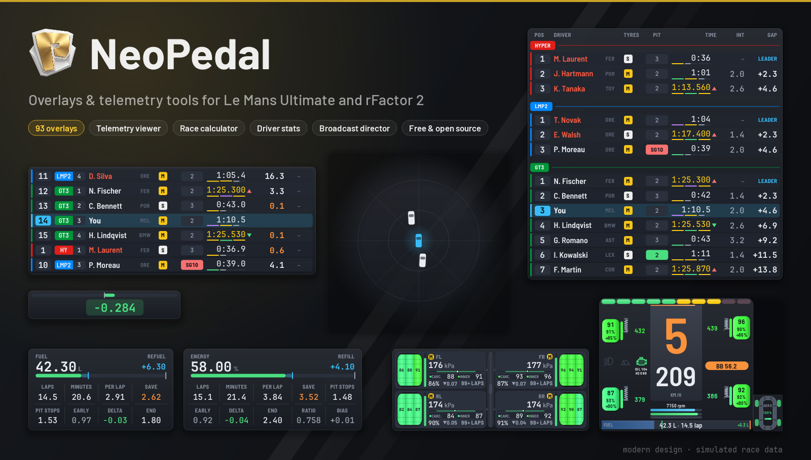
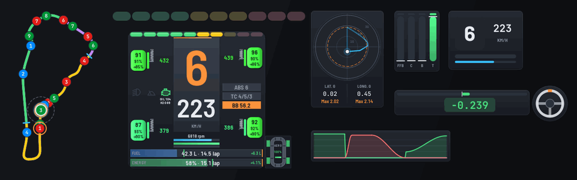
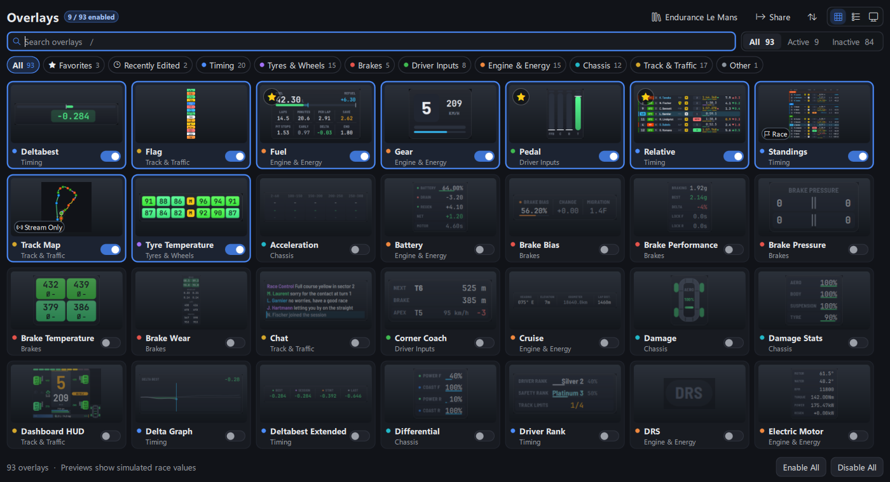
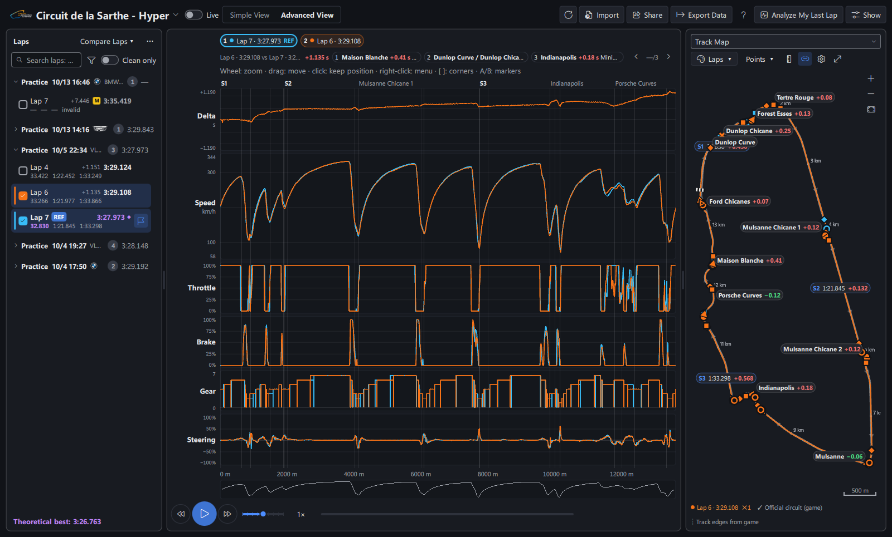
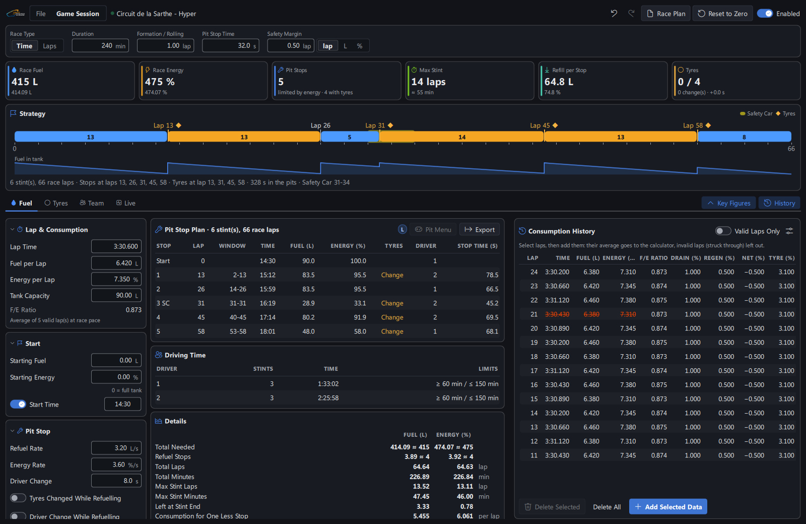
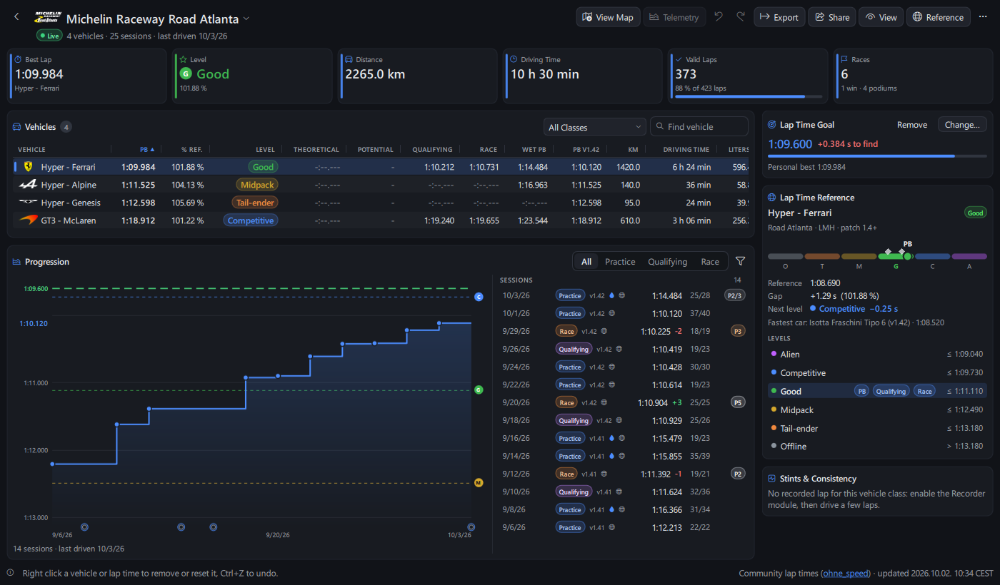
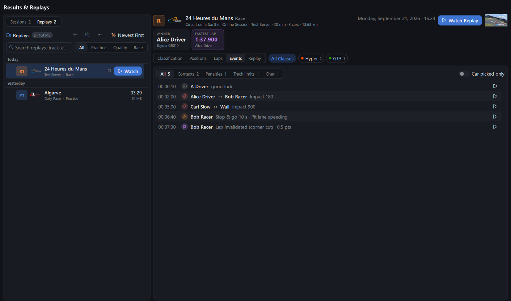
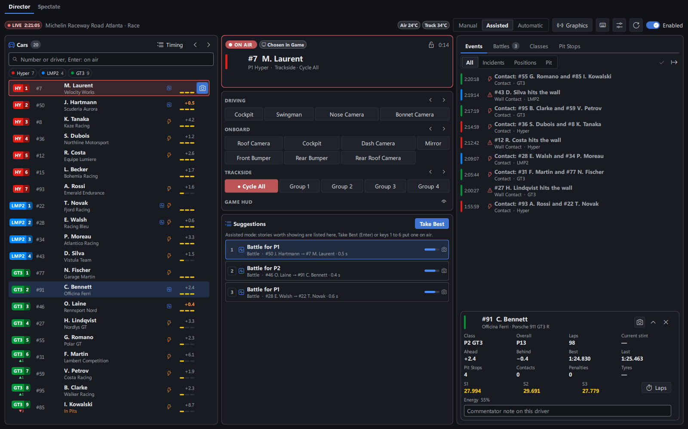
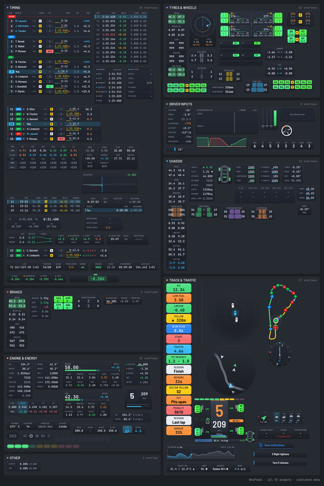

<p align="center">
  <a href="https://github.com/Keenny38/NeoPedal/releases/latest">
    
  </a>
</p>

<p align="center">
  <a href="https://github.com/Keenny38/NeoPedal/releases/latest"></a>
  <a href="https://github.com/Keenny38/NeoPedal/releases"></a>
  <a href="LICENSE.txt"></a>
  
</p>

<h3 align="center">
  <a href="https://github.com/Keenny38/NeoPedal/releases/latest">📥 Download for Windows</a>
</h3>

<p align="center">
  <a href="#-quick-start">Quick start</a> ·
  <a href="#-what-you-get">Features</a> ·
  <a href="#-safe-to-use">Safe to use</a> ·
  <a href="https://github.com/Keenny38/NeoPedal/wiki">Wiki</a> ·
  <a href="CHANGELOG.md">Changelog</a> ·
  <a href="#-support-the-project">Support</a>
</p>

<p align="center"><b>English</b> · <a href="README.fr.md">Français</a></p>

<p align="center"></p>

---

**NeoPedal** is much more than an overlay app: it's a complete companion for your races in **Le Mans Ultimate** and **rFactor 2**. 93 overlays with a modern design, a telemetry viewer, a race strategy calculator, your driver stats, your results and replays, a broadcast director and stream sources, all in one app.

Free, open source, in English and French. A personal project I build in my free time, with the help of AI, on top of [TinyPedal](https://github.com/TinyPedal/TinyPedal) (approved by its developer and listed in its [community projects](https://github.com/TinyPedal/TinyPedal/wiki#community-projects)).

## 🏁 Quick start

1. **Download** `NeoPedal-<version>-windows-setup.exe` from the [Releases](https://github.com/Keenny38/NeoPedal/releases/latest) and run it. No administrator rights needed.
2. **Set the game** to `Borderless` or `Windowed` (exclusive fullscreen hides overlays).
   - **Le Mans Ultimate**: nothing to install, turn on `Settings > Gameplay > Enable Plugins`.
   - **rFactor 2**: install the [rF2SharedMemoryMapPlugin](https://github.com/TheIronWolfModding/rF2SharedMemoryMapPlugin#download) ([details](https://github.com/Keenny38/NeoPedal/wiki/Game-Setup)).
3. **Launch NeoPedal**: the setup wizard asks for your language, game, units, theme and the overlays to start with.
4. **Drive**: overlays show as soon as your car is on track. Unlock them to drag them where you want.

Updates are found and installed from the app. Linux: see [Run from source](#-run-from-source).

## 🧰 What you get

<table>
<tr>
<td width="50%" valign="top">

### 93 overlays, one modern design
Standings and Relative like a TV timing tower, delta, tyres, brakes, fuel and virtual energy, radar, track map, flags, weather, Dashboard HUD and much more. Same colors everywhere (purple best, green gain, red loss), four themes, colorblind variants, and the classic look still there.

</td>
<td width="50%" valign="top">



</td>
</tr>
<tr>
<td valign="top">



</td>
<td valign="top">

### Telemetry viewer
Every lap recorded and drawn by the graphics card. Compare laps, see **where you lose time** in plain words ("Brakes 6 m earlier"), racing line on the official track map, session pace, MoTeC import and export, and your reference lap live on track.

</td>
</tr>
<tr>
<td valign="top">

### Race calculator
Fuel, virtual energy and tyres on one page: pit stop plan lap by lap, safety car and rain scenarios, several drivers with driving times, and the plan recalculated **live** every lap from your car.

</td>
<td valign="top">



</td>
</tr>
<tr>
<td valign="top">



</td>
<td valign="top">

### Driver stats
Your times per track and car against the LMU community lap times, with your level from Alien to Offline, progress session after session, lap time goals, wet and dry bests, and sessions imported from the game results.

</td>
</tr>
<tr>
<td valign="top">

### Results & Replays
Every session you played, online or offline, read from the game files: classification, positions lap by lap, contacts and penalties, with a play button that opens the **replay at that moment**.

</td>
<td valign="top">



</td>
</tr>
<tr>
<td valign="top">



</td>
<td valign="top">

### Broadcast Director & stream
Cast a Le Mans Ultimate race live or in a replay: every camera in one click, an assisted or automatic director (battles, overtakes, contacts, pit stops), TV graphics for OBS, and every overlay as a browser source.

</td>
</tr>
</table>

**And also**: Home page that checks what keeps your overlays from showing, Upcoming Races with reminders, web dashboard for your phone, hotkeys on your wheel or button box, Stream Deck and SimHub remote control, SteamVR overlay, presets per car class and track, command palette (`Ctrl+K`), session recorder.

<details>
<summary><b>See all 93 overlays</b></summary>



</details>

Every feature in detail: [wiki](https://github.com/Keenny38/NeoPedal/wiki).

## 🔒 Safe to use

- **No cheat, no game file changed.** NeoPedal reads what the game shares with plugins (shared memory), the game's own result files and its local REST API, on your PC.
- **Never signs in as you.** Since 0.29.1, NeoPedal no longer calls RaceOS (LMU's online service that uses your Steam login), as asked by the game developers.
- **You can check every request.** The `Requests` button lists everything the app sends outside (GitHub for updates, community lap times, the public RaceControl site, badge icons), with the count for the last hour.
- **Signed updates**, checked before install, and more than 6,000 automated tests run on every change.

## 💻 Run from source

Needs [Python](https://www.python.org/) 3.11 or newer. Windows:

```bash
git clone https://github.com/Keenny38/NeoPedal.git
```

```bash
cd NeoPedal
```

```bash
py -3.12 -m venv .venv
```

```bash
.venv\Scripts\activate
```

```bash
pip install -r requirements.txt
```

```bash
python run.py
```

**Linux** runs from source the same way (`PySide6`, `psutil`, `cryptography`, `pyxdg`); `sudo ./install.sh` adds a launcher and the `NeoPedal` command. See [Installation](https://github.com/Keenny38/NeoPedal/wiki/Installation#linux).

## 🤝 Contributing

Found a bug or have an idea? Open an [issue](https://github.com/Keenny38/NeoPedal/issues), or chat with me on Discord: my username is `keenny`. Development setup and rules are in [CONTRIBUTING.md](CONTRIBUTING.md). Security issues are reported privately: [SECURITY.md](SECURITY.md).

## 💛 Support the project

NeoPedal is free and will stay free. If it helps you on track, you can support it:

- ❤️ Patreon (optional): https://www.patreon.com/cw/keenny38
- ☕ Ko-fi (optional): https://ko-fi.com/neopedal

## 📜 License and credits

Copyright (C) 2022-2026 TinyPedal developers, see [NOTICE.md](NOTICE.md) and [docs/contributors.md](docs/contributors.md).

Free software under the [GNU GPL v3](LICENSE.txt) or any later version, WITHOUT ANY WARRANTY. The icon and the images of the `images` folder are under [CC BY-SA 4.0](https://creativecommons.org/licenses/by-sa/4.0/), except the country flags (`images/flags.png`, from [flag-icons](https://github.com/lipis/flag-icons), MIT license, `docs/licenses/LICENSE.flag-icons.txt`). The [Barlow](https://github.com/jpt/barlow) font is under the SIL Open Font License 1.1 (`fonts/OFL-Barlow.txt`). Third-party licenses: [docs/licenses](docs/licenses/THIRDPARTYNOTICES.txt).
