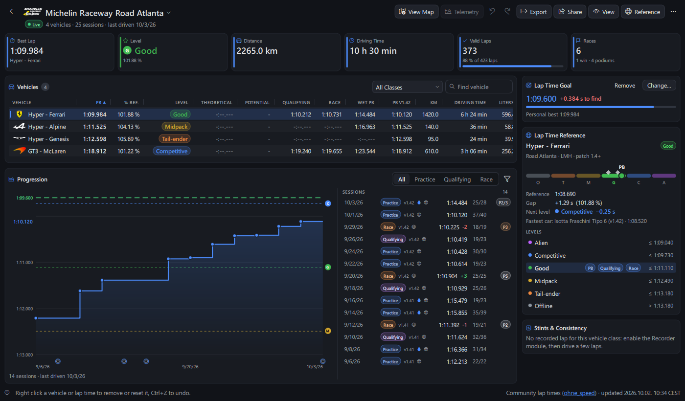

# Driver Stats

The **Driver Stats** page shows your numbers per track and per car: personal bests, distance, races, results. With Le Mans Ultimate, your lap times are compared with community lap times and placed on a level ladder, from **Alien** to **Offline**.

Open it with the `Stats` entry of the navigation bar, or the `Tools` page.

| Track: goal, filters, wet PB, sessions | All tracks: driving time by track & class, official races |
|---|---|
|  |  |

## Layout

One view, no tabs: the table, what goes under it, and every card in the column beside it (it scrolls; below the table on a narrow window).

| | Under the table | Cards beside it |
|---|---|---|
| **Track** | progression chart & sessions of the selected car (the table shows every row when it fits) | lap time goal, stints & consistency, lap time reference (levels), friends & codes |
| **All Tracks** | daily driving activity | driver, **This Week**, recent sessions, levels of all tracks, rivals, friends & codes |

Columns without any value (theoretical best without recorded laps, a class without lap time, no wet session...) are left out until a row has one. Cars with nothing to show (no lap time, no lap, under 1 km: a car loaded then left) are hidden; `⋯` > `Clean Up Stats (Empty Cars, Impossible Lap Times)` removes them for good, with lap times longer than an hour (a game clock jump after a disqualification), and `Ctrl+Z` undoes it. An amber **Last Driven** date means 30 days or more without driving that track (the footer says it while the table shows one).

**This Week** sums up your last 7 days: sessions, driving time and laps, goals reached, new personal bests (with the time gained) and goals within half a second (automatic goals included). Click a line to open its track with its car selected. The Home page shows the same feed in its `This Week` card (`stats_analysis.weekly_progress`).

## How stats are recorded

The **Stats** module (`Module` page) records your stats and saves them when you return to the garage, and every 5 minutes while you drive (kept if the app or the computer stops). A lap invalidated by Le Mans Ultimate (track limits) counts as an invalid lap and never as a best lap time. Each driving stint is also added to the session history. Stats are stored in the global config folder (`.stats` files and `driver.history`).

Stats are **not** recorded while:

- `enable_player_index_override` or `enable_active_state_override` is on in the API options (spectating, overrides);
- the app runs with several instances allowed (`--single-instance 0`);
- a teammate drives your car in a team race (Le Mans Ultimate, driver at the wheel other than the one of the stint).

With each session, the Stats module also records the **road conditions of your best lap** (road wetness, track temperature, tyre compound; the wettest road of the session when it has no lap time), your **start position** in races (class or overall, like the finish position) and whether you drove on an **online server** (Le Mans Ultimate: asked once per session to the game, never waiting for it). Sessions recorded before 0.27.0 have none of these: online or offline and the start position are then taken from the game results file of the session when there is one.

The `vehicle_classification` option of the Stats module sets how cars are grouped: `Class - Brand` (default), `Class` or `Vehicle` (not recommended: every car has its own name). Community comparison needs the class (`Class - Brand` or `Class`). `enable_podium_by_class` counts finish positions in your class.

## Track view

The track name is the page title: click it to pick another track (type to search, `Up` / `Down` and `Enter` to choose, or press `/`). Below it: number of vehicles and sessions, last driven date, and a `Live` badge when it is the track of the running game session. The arrow on the left (`Alt+←`) goes back to `All Tracks`.

The key figures add up all cars: best lap and its car, its level (with its letter), distance, driving time, valid laps (with their share), races, wins and podiums.

The vehicle table lists each car or class with, among others:

- personal best, gap to the community reference (`% Ref.`) and **level**;
- **theoretical best** (sum of your best sectors) and **potential** (personal best minus theoretical best);
- qualifying and race bests, distance, driving time, fuel used, valid and invalid laps;
- race starts (counted when you drive at the green flag), finishes, wins, podiums, DNF, win and podium rates, average finish position, penalties;
- average speed, fuel consumption per 100 km, last driven date;
- **Wet PB** (best lap on a damp or wet road), **PB of the latest game version** of your history (`PB v1.42`), average **places gained** in races and **% clean** races (no contact, no penalty, from the game results files).

The **last driven** date turns amber when a car (or track) has not been driven for 30 days: worth a warm-up before racing it. The tooltip of a personal best says when it is the fastest of its class.

Above the table: **search** by name and a **class** list (when the table has several classes). `View` > `Group Cars by Class` sorts the cars class by class (each class keeps the sort column), with a line between classes.

Click a column name to sort (rows slide to their new place). `View` > `Columns` (or right-click the column names) shows or hides columns; drag a column edge to resize it. Missing values are dimmed, levels shown as colored badges.

Keyboard in the table: `Up` / `Down`, `Page Up` / `Page Down`, `Home` / `End` to move, `Enter` to open a track, `Delete` to remove the selected car (or track), `Backspace` to go back to `All Tracks`, `Menu` for the right-click menu. `F5` reloads the stats.

The **Lap Time Reference** card shows the **level scale** of the selected car: the six levels from `Offline` (left) to `Alien` (right), your personal best (round mark) and your qualifying and race bests (diamonds) placed on it. Hover a level for its lap time limit, a mark for its lap time. Below: the reference lap time, your gap, the **time to find for the next level**, the fastest car, and the list of levels with the lap time of each one and badges where your bests stand (folded by default, the chevron next to `Levels` shows it; the choice is kept).

## Lap time goal

The **Lap Time Goal** card keeps a lap time to beat for the selected car. It is **automatic**: the limit of the next level of community lap times above your personal best (the community reference without a personal best; half a second under your personal best at the best level or without community lap times). Once a new personal best reaches the next level, a message tells you once (`Level reached`) and the goal moves to the level after. `Set…` keeps a lap time of your own instead (a message once beaten, even while the page was closed); `Automatic` goes back to the automatic goal. The card shows the time left to find (to the millisecond) and a progress bar from your first lap time to the goal; the goal is a green dashed line on the progression chart. The Home page debrief and **This Week** use the same goals. Goals set are kept in the app config (`driver_stats_viewer` > `goals`, levels told in `goal_levels`).

## All Tracks (career)

`All Tracks`, first entry of the track selector, is the page that opens (also when you come back after 2 minutes away). It shows your career on one page: each track with the best lap of each class, colored by its level, track totals and last driven date, plus the count of your best laps per level. Double-click a track to open it. `View` > `Sort Tracks by Last Driven` lists recent tracks first.

- **Activity**: a calendar of the last 12 months (or of a year picked at the top right), one square per day colored by your driving time (all tracks), with the days driven, the total time and your longest streak. Hover a day for its sessions. `Breakdown` (next to `Days`) shows instead the **driving time by track** (most driven first, others summed) **and by class** over the same period; the choice is kept.
- **Rivals**: people of your class met in two online races or more (game results files): races together, times you finished ahead and behind, and the mean gap of your best laps. Hover a row for details; click it (or `Enter`) for a menu on your last race together: show its track & car, open its recorded laps, prepare the race in the [Race Calculator](Race-Calculator.md), or open its results.
- **Recent Sessions**: your latest sessions on every track, with the best lap (★ when it was your personal best), the race result and the session type. Click one to open its track with its car selected.
- **Driver**: name, country, team and number of your game profile (`UserData/player/Settings.JSON`), your Steam profile picture (from Steam's own cache, nothing is downloaded), and your races in the game results files (races, wins & podiums in the `Races` key figure): average finish, clean races (no contact, no penalty), contacts per race, your current **clean streak** and the average **places gained** from start to finish. Positions are class positions. With Le Mans Ultimate, your **Driver Rank** and **Safety Rank** too, as the game menu shows them, each in its color with the progress to the next tier, and the change since your previous rank (`▲ +10%`): every change of rank is kept in `driver_ranks.history` of the global config folder, and drawn as a small **rank history** line under each rank (scaled to the tiers reached, so a few percent show). The ranks are read again from RaceControl while the game runs (online ranks option); `Refresh` next to their date asks again now (a few minutes apart: RaceControl refuses a connection after too many). Your **badge** as well (`Good Driver`, `Trusted Racer`, `Rookie`, `Warning`...), with the game's icon, name and description; the icon is downloaded once from Studio 397's public image server (no sign-in) and kept in `gameimage/badge`. **Several game accounts** on one computer (several Steam accounts): ranks are kept per account, the account in use is the one signed in to Steam (followed live), and your other accounts are listed below with their Steam name and picture, last ranks seen, badge and date. When the game rewrites its menu file without your ranks, the last ranks seen of the account in use are shown with their date (ranks saved before 0.24.0, without their account, go to the account in use when no other account has saved ranks).

### Complete lap times from race results

Sessions played before the Stats module recorded them, or with the app closed, are still in the game results files. When a best lap of an LMU results file is missing from your stats, or faster than your personal, qualifying or race best, they are **taken at once** (each one once): a message lists every change (track, car, lap time before and after, date) with `Undo`; the stats file is backed up first and `Ctrl+Z` undoes it too. A lap time undone is never taken again on its own: the **Driver** card still shows it, with `Complete…`.

- The car is the one of the session history when the session is linked to it, else found from the results (class, brand in the car name, or vehicle name, following `vehicle_classification`).
- Laps invalidated by track limits have no time in LMU results files; in team races, only the laps you drove count.
- rFactor 2 results files are not used here (they keep times of invalid laps).

### Import sessions from game results

Le Mans Ultimate keeps a results file of every session in `UserData/Log/Results`, so sessions driven before you installed NeoPedal, or with the Stats module off, can still be added. The **Driver** card (`All Tracks`) tells how many sessions of the game are not in your stats, with `Import…`: each one is added to your stats and session history as the Stats module would have recorded it, and the toast says how many were imported (`Undo` there, or `Ctrl+Z`; the stats file and history are backed up first).

- Counted: valid and invalid laps, personal, qualifying and race bests, distance (laps x track length) and driving time, race starts, finishes, wins, podiums (class positions with `enable_podium_by_class`), retirements, penalties, grid and finish position, tyre compound of the best lap, game version, online or offline. Only the laps you drove count in team races.
- Not in results files: fuel used and road conditions (wetness, track temperature) stay unknown for these sessions. Distance and driving time are estimated from the laps (out laps and laps back to the garage count as a part of a lap), within a few percent of what the Stats module records.
- Cars get the name the Stats module gives them (`vehicle_classification`: class, class & brand, or vehicle name), tracks the layout name.
- Never counted twice: a session linked to your history, or with a stint recorded on its track while it ran, is left out, and so is an older session of a track & car whose stats count laps recorded before session history existed (Modern Tiny Pedals and TinyPedal stats). A session where you drove no lap is left out too.

### Import from mysimrace

If you used [mysimrace](https://www.mysimrace.com) before NeoPedal, export your data there (a `.json` file) and pick it with `⋯` > `Import From mysimrace…` in the Driver Stats toolbar. Laps in a row on one track, car and session type become a session, added to your stats and session history; the toast says how many (`Undo` there, or `Ctrl+Z`; the stats file and history are backed up first).

- Counted: valid laps, driving time (sum of the lap times), personal, qualifying and race bests, tyre compound of the best lap when the export has it. Distance is laps x track length, known from a results file of Le Mans Ultimate on that track (0 without one).
- Not in the export: invalid laps, race results (start, finish, position, wins, podiums), fuel and road conditions. Only laps of Le Mans Ultimate classes are read.
- Cars get the name the Stats module gives them (`vehicle_classification`; the vehicle name setting uses the car model, the export has no livery name), tracks the layout name (`Circuit de la Sarthe (24H)` becomes `Circuit de la Sarthe`).
- Never counted twice: a session with a stint of your history recorded while it ran or right after it, or inside a session of a results file of the game (import it from game results instead, with more data), is left out. Importing the same file again adds nothing.

## Community levels

Personal bests are compared with the community LMU lap time sheet of [ohne_speed](https://www.youtube.com/@ohne_speed) (a published Google Sheet: reference hotlap per track and class, ladder up to 107 %):

| Level | Personal best vs class reference |
|---|---|
| `Alien` | about 100 % |
| `Competitive` | 101 % |
| `Good` | 102-103 % |
| `Midpack` | 104-105 % |
| `Tail-ender` | 106 % |
| `Offline` | 107 % and slower |

The sheet's 101 % column is the slowest lap time of 101 % (101.5 % of the class reference), and so on: a lap time equal to a limit as shown counts in that level. The ladder is a **race pace** ladder: the level is the one of your personal best, your qualifying and race bests are marked on the ladder of the reference card. `Theoretical` (best sectors) and `Potential` are of the **class**, as the Sectors module keeps them: best sectors may be of another brand.

The sheet is downloaded once a day when the page opens and kept for offline use, as **xlsx** (exact values: lap times and level limits to the millisecond; the CSV export of a sheet rounds them to the hundredth and is used only when the xlsx one can't be read). A download cut by the network or the server is tried twice more; when it fails while a copy is kept, the footer says `update failed`. A level limit is the millisecond under the exact sheet value, so a lap time is placed exactly as the sheet formula does (the sheet shows hundredths rounded twice, a few limits differ by 0.01 s from what it shows). The `Races` key figure of All Tracks counts the game results files, as the **Driver** card (races before NeoPedal included); the fuel consumption leaves out sessions imported from results files (no fuel in them). The `Reference` menu has `Update Reference`, `Change Sheet Address…` (another sheet with the same layout) and `Compare With Community Lap Times` (on or off). `View` > `Colorblind Colors` uses colors easier to tell apart.

Texts of the sheet (its update date) are shown as plain text, and the source link at the bottom of the page opens only an `https://` address: a sheet of someone else cannot show pictures from the network or open a program.

## Progression and sessions

Under the table, side by side (one at a time with the list button when the window is narrow):

- **Progression** (under the table of a track): best lap of each session (dots, new personal bests highlighted, a ring around wet road laps) and your personal best over time (line over a shaded area), with round lap time grid lines, the level limits (dashed, level letter at the end) and your goal. Filter by `All`, `Practice`, `Qualifying` or `Race`; the filter applies to the sessions list too. The **filter button** next to it keeps the sessions of a **road** (dry or wet), a **server** (online or offline) or **since a game version** (kept between sessions); the line under the chart then gives your best with these filters, and each filter in use shows as a chip above the chart: click it to remove that filter alone (`Clear Filters` removes them all). Hover a session of the list to point it on the chart; click a point of the chart to show its session in the list. The line under the chart gives the date of your personal best and the game version it was set with (`PB 1:09.984 set on 03/10/2026 · Version 1.42`).
- **Sessions**: sessions of the selected car, newest first: date, session type, game version (`v1.42`), a drop for a wet road, a globe for an online server, best lap (★ personal best), places gained or lost (`+3`), valid laps, race result (position, podium in color, DNF or DQ), or your class position from the game results file (`P3/12`). A lightning mark shows contacts or penalties. The tooltip adds driving time and distance and, from the results file, position, gap, contacts, penalties, track limits points, online or single player and server. Click a session linked to a results file to open it in [Results & Replays](Race-Results.md).
- **Stints & Consistency** (beside the table; one line when no lap of the class was recorded): pace and lap time change per lap **by tyre compound** over your recorded stints, and a **consistency index** per session and per track (lap time spread of clean laps; lower is more consistent).

The game version is recorded with each session since 0.23.0 (Le Mans Ultimate); older sessions take it from the game results file of the session. Sessions are linked to the game results files by track, session type and time.

## Compare with a friend

1. Your friend exports their history: `Export` > `Session History for a Friend (JSON)…`.
2. You load that file with `Reference` > `Compare With a Friend's Stats…` (or the button of the **Friends & Codes** card). Their times show in that card.
3. `Reference` > `Stop Comparing With Friend` (or the ✕ of the card) returns to your stats only.

## Share your personal best

The `Share` menu works on the selected car:

- `Copy Personal Best Card` / `Save Personal Best Card…`: a picture (1200 × 630) with the track, car, lap time, level, gap to the community reference, your name and the date, to paste in Discord or a forum;
- `Copy Personal Best Code`: one line of text (`NP1:pb:…`) to paste in a chat;
- `Compare a Personal Best Code…` (also in the **Friends & Codes** card): reads a code (copied, or pasted in the box) and compares it with your best of the same track and class; when it is faster, it offers to make it your goal.

## Export

The `Export` menu saves:

- `Export CSV…`: the table as shown (visible columns);
- `Export Raw Values (CSV)…`: base units without formatting (lap times in seconds, distance in meters, fuel in liters), for spreadsheets;
- `Session History (CSV)…` (with start position, road wetness, track temperature, compound, online and game version of each session) and `Session History for a Friend (JSON)…`.

## Open the telemetry

The `Telemetry` button (or right-click > `Open Recorded Laps`) opens the recorded laps of the selected car class in the [Telemetry Viewer](Telemetry-Viewer.md), with your personal best lap as reference. `View Map` shows the track map.

## Edit and backups

The viewer never lets you edit a value, only reset or remove:

- right-click a lap time > `Reset Lap Time`;
- right-click a car > `Remove Car`;
- `⋯` > `Delete All Stats of This Track` removes all stats of the track (or `Delete` on a track of `All Tracks`).

Before each change, the stats file is backed up (the last 10 are kept), with the session history when the change removes or changes sessions: `⋯` > `Restore Backup` puts both back (sessions recorded since are kept). `Undo` / `Redo` (`Ctrl+Z` / `Ctrl+Y`) work while the page is open (they wait while an edit is being saved), and stats recorded meanwhile are kept. `⋯` > `Reload` (`F5`) reads the stats file again (the page also reloads by itself when the Stats module saves).

All options: [Driver stats viewer](https://github.com/Keenny38/NeoPedal/blob/master/docs/customization.md#driver-stats-viewer) and [Stats module](https://github.com/Keenny38/NeoPedal/blob/master/docs/customization.md#stats-module).
